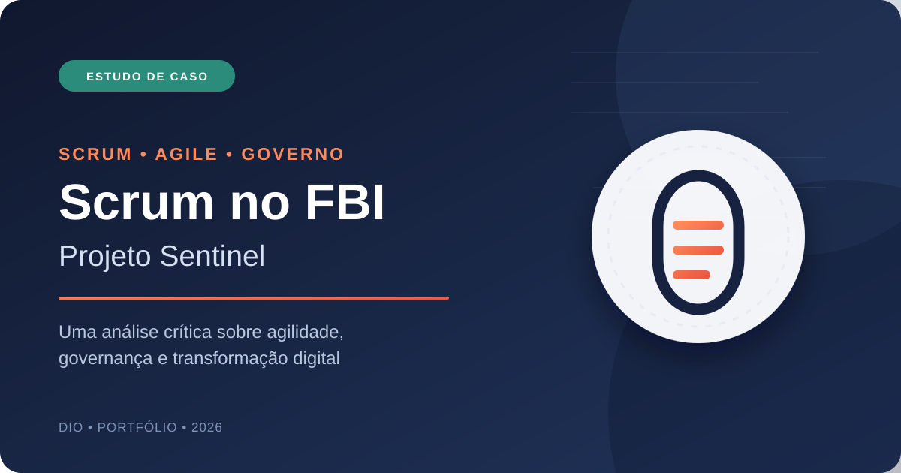
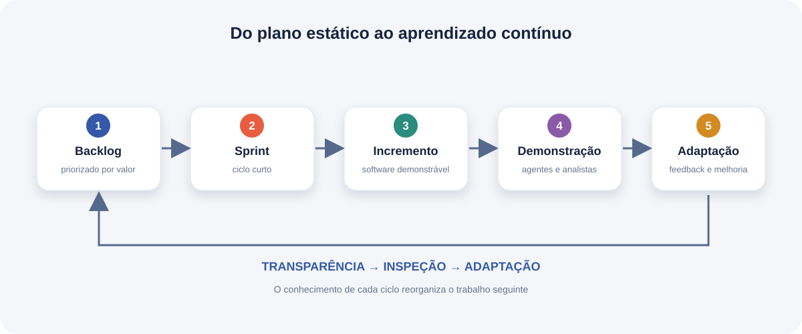
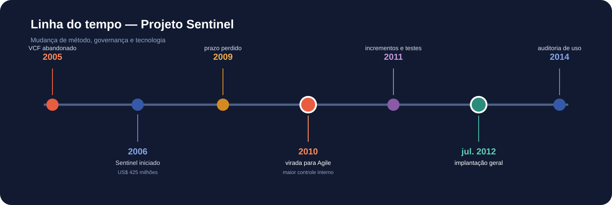

<div align="center">



# Scrum no FBI: o caso Sentinel

### Uma análise crítica sobre agilidade, governança e transformação digital

[](docs/RESENHA_CRITICA.md)
[](https://scrumguides.org/)
[](docs/MATRIZ_SCRUM.md)
[](#)

Projeto desenvolvido para o desafio **“Scrum: Analisando Cases de Sucesso”**, da DIO.

</div>

## Sobre o projeto

Este repositório analisa a recuperação do **Sentinel**, sistema de gerenciamento de informações e casos do FBI. Depois de atrasos, custos elevados e problemas de integração, o órgão assumiu maior controle do desenvolvimento e adotou uma abordagem ágil fortemente influenciada por Scrum.

A análise não repete apenas a narrativa de sucesso. Ela compara relatos de praticantes com documentos do **FBI**, do **Government Accountability Office (GAO)** e do **Office of the Inspector General (OIG)** para responder a três perguntas:

1. Quais práticas de Scrum aparecem no caso?
2. O que realmente contribuiu para a recuperação do projeto?
3. Quais limitações são escondidas por afirmações como “90% de economia”?

> **Conclusão central:** Scrum ajudou a tornar o trabalho visível, inspecionável e adaptável, mas não atuou sozinho. Internalização da equipe, mudança de contratos, priorização de escopo, modernização técnica e patrocínio executivo também foram determinantes.

## Entrega principal

📄 **[Leia a resenha crítica completa](docs/RESENHA_CRITICA.md)**

Também estão disponíveis:

- [linha do tempo comentada](docs/LINHA_DO_TEMPO.md);
- [matriz de análise do Scrum](docs/MATRIZ_SCRUM.md);
- [roteiro de apresentação](docs/APRESENTACAO.md);
- [referências anotadas](docs/REFERENCIAS.md);
- [versões em PDF e DOCX](entrega/);
- [guia de entrega na DIO](ENTREGA_DIO.md).

## O caso em números

| Marco | Informação | Leitura crítica |
|---|---:|---|
| Início do Sentinel | 2006 | O projeto sucedeu o VCF, mas não deve ser confundido com ele |
| Previsão inicial | dezembro de 2009 | Estimativas de custo e prazo foram questionadas por auditorias |
| Estimativa inicial | US$ 425 milhões | Depois revisada para US$ 451 milhões |
| Situação após a fase 2 | cerca de US$ 405 milhões gastos | A fase estava aproximadamente 32% acima do orçamento |
| Mudança para Agile | 2010 | Incluiu mudanças de equipe, contratos, liderança e escopo |
| Implantação geral | 1º de julho de 2012 | Confirmada pelo FBI |
| Custo informado em 2012 | US$ 441 milhões | Não incluía todos os custos de pessoal e dois anos de O&M |
| Orçamento acumulado em 2014 | US$ 551,4 milhões | Incluía manutenção e novas funcionalidades posteriores |

Fontes e contexto completo: [Referências](docs/REFERENCIAS.md).

## O que mudou com a abordagem ágil



- ciclos curtos em lugar de grandes entregas tardias;
- demonstração frequente de software funcionando;
- participação contínua de agentes e analistas;
- backlog ordenado pelo impacto para o usuário;
- equipe menor e mais integrada;
- liderança voltada à remoção de impedimentos;
- adaptação do plano a partir de evidências.

## Linha do tempo



A versão detalhada, com fontes e observações, está em [Linha do Tempo](docs/LINHA_DO_TEMPO.md).

## Análise crítica

### Pontos fortes

- feedback de usuários passou a orientar decisões;
- incrementos demonstráveis substituíram progresso apenas documental;
- ciclos curtos reduziram o risco de erro tardio;
- decisões foram aproximadas da equipe;
- o sistema foi efetivamente implantado para toda a organização.

### Limites da narrativa de sucesso

- o FBI declarou oficialmente uma abordagem **Agile**; a descrição de Scrum vem principalmente de relatos de praticantes;
- não há documentação pública suficiente para comprovar todos os eventos, artefatos e accountabilities do Scrum;
- a economia da etapa final não equivale ao custo total do programa;
- requisitos foram priorizados, transferidos ou modificados;
- auditorias posteriores apontaram problemas de busca, indexação e custos de evolução.

Por isso, este trabalho classifica o caso como uma **transformação ágil fortemente influenciada por Scrum**, e não como prova de uma implementação “pura”.

## Principais aprendizados

1. Agilidade exige mudança de governança, não somente reuniões novas.
2. Software funcionando fornece mais transparência que percentuais subjetivos.
3. Feedback frequente reduz o risco de construir o produto errado.
4. Priorizar valor significa adiar conscientemente parte do escopo.
5. Liderança ágil remove impedimentos em vez de apenas cobrar velocidade.
6. Custos devem ser comparados usando a mesma fronteira contábil.
7. Implantação não encerra o produto: qualidade e satisfação continuam sendo medidas.
8. Um framework pode contribuir para o sucesso sem ser sua única causa.

## Estrutura

```text
scrum-case-fbi-sentinel/
├── assets/
│   ├── capa.svg
│   ├── capa-documento.png
│   ├── ciclo-scrum.svg
│   └── linha-do-tempo.svg
├── docs/
│   ├── APRESENTACAO.md
│   ├── LINHA_DO_TEMPO.md
│   ├── MATRIZ_SCRUM.md
│   ├── REFERENCIAS.md
│   └── RESENHA_CRITICA.md
├── entrega/
│   ├── Resenha_Critica_FBI_Sentinel.docx
│   └── Resenha_Critica_FBI_Sentinel.pdf
├── scripts/
│   ├── generate_deliverables.py
│   └── validate_project.py
├── tests/
│   └── test_project.py
├── CONTRIBUTING.md
├── ENTREGA_DIO.md
├── LICENSE
├── Makefile
├── README.md
└── requirements.txt
```

## Metodologia

O trabalho foi construído por triangulação de fontes:

- **fontes primárias:** comunicados do FBI e auditorias governamentais;
- **referência normativa:** Scrum Guide 2020;
- **relato de praticante:** capítulo de Jeff Sutherland sobre o caso;
- **análise crítica:** comparação de cronologia, custos, escopo e resultados posteriores.

Os números foram mantidos no contexto em que cada fonte os apresenta. Valores de desenvolvimento, pessoal, operação e manutenção não foram somados ou comparados como se representassem a mesma coisa.

## Execução local

**Requisito:** Python 3.10 ou superior.

Os documentos finais já estão disponíveis em [`entrega/`](entrega/). Para regenerá-los e executar a validação:

```bash
python -m venv .venv
source .venv/bin/activate          # Linux ou macOS
# Windows PowerShell: .\.venv\Scripts\Activate.ps1
# Windows CMD: .venv\Scripts\activate.bat
python -m pip install -r requirements.txt
python scripts/generate_deliverables.py
python scripts/validate_project.py
python -m unittest discover -s tests -v
```

O projeto funciona localmente, utiliza somente bibliotecas gratuitas e não depende de APIs, credenciais ou serviços pagos.

## Originalidade do trabalho

Este projeto foi desenvolvido do zero para esta entrega. Ele **não reproduz textos, slides, conclusões ou modelos prontos da aula**. O caso foi reexaminado a partir de documentos públicos, e a argumentação, a organização do repositório, a matriz comparativa e os diagramas são autorais.

As informações factuais de terceiros estão acompanhadas das respectivas referências. A contribuição própria está na triangulação das fontes e na tese crítica: o Scrum contribuiu para a recuperação do Sentinel, mas não explica o resultado isoladamente.

## Autor

Desenvolvido por [0Barone](https://github.com/gabrielnasciimentoleandro-arch) como projeto de portfólio para a formação da DIO.

## Licença

Conteúdo disponibilizado sob a licença [Creative Commons Atribuição 4.0 Internacional](LICENSE).
